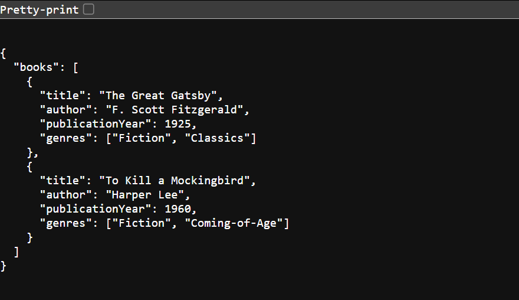
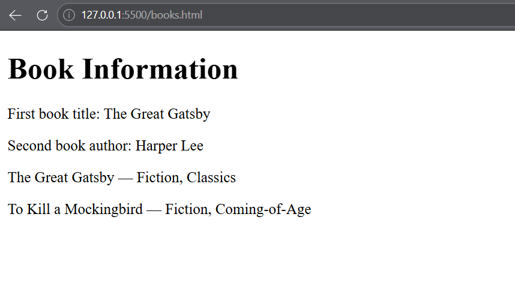
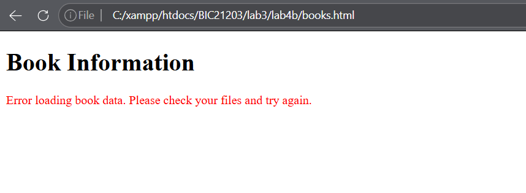
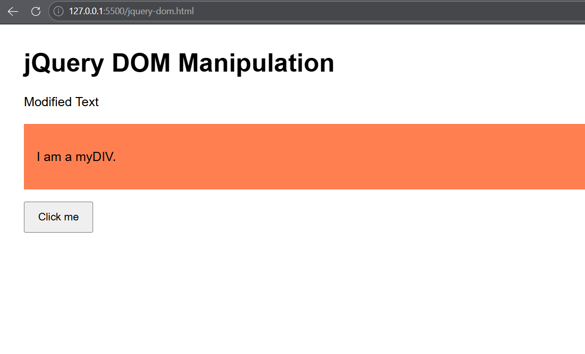
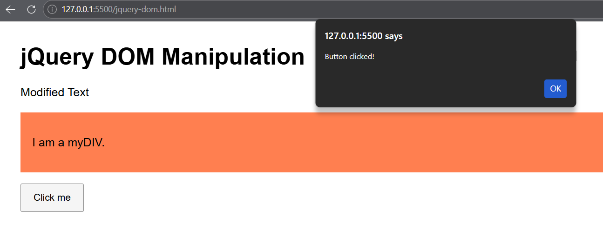

# BIC21203 Web Development
## LAB 4B: CLIENT-SIDE SCRIPTING (JSON AND JQUERY) 

### Student Information
- **Name:** IMAN NUR IZZAH BINTI MOHD RAFIZAN
- **Matrics No.:** AI250113
- **Section:** 7

### Repository Link
[Paste your GitHub repository URL here]

### Introduction
This lab focuses on creating and structuring JSON data, retrieving data using the JavaScript Fetch API, and manipulating HTML elements using jQuery.

### Question 1: Create and Structure JSON Data
Created a `books.json` file containing a `books` array with two book objects. Each book includes a title, author, publication year, and genres. The JSON structure was checked to ensure it uses valid syntax and correct data types.

### Question 2: Fetch API and Display JSON Data
Created a `books.html` webpage using the JavaScript `fetch()` API to read `books.json`. The webpage displays the first book's title, the second book's author, and the genres of both books. Error handling is included to display a user-friendly message if the request fails or the JSON data is invalid.

### Question 3: jQuery DOM Manipulation
Created a `jquery-dom.html` webpage using jQuery 4.0.0. The `.text()` method changes the text of an HTML element, `.addClass()` applies the `myStyle` CSS class, and `.on("click", ...)` displays an alert when the button is clicked.

### How to Run
1. Download or clone this repository.
2. Open the project folder in Visual Studio Code.
3. Start a local server using Live Server.
4. Open `books.html` to test Question 2.
5. Open `jquery-dom.html` to test Question 3.
6. Ensure an internet connection is available to load the jQuery CDN.

### Screenshots

### Question 1: Interactive Text Changer

### Question 2: Smart Number Validator

### Question 3: Dynamic Number Generator

### Reflection
Through this lab, I learned how to structure JSON data, retrieve information by using the JavaScript Fetch API, and manipulate HTML elements using jQuery. I also learned the importance of valid JSON syntax, error handling, and event handling. These exercises improved my understanding of client-side scripting and interactive web development.

